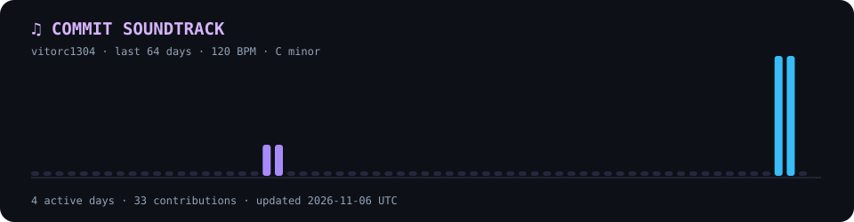

<div align="center">

# Vitor Carneiro Araújo

### `Developer in progress...`

**Information Systems Student | AI & Cybersecurity Enthusiast**

*Exploring technology, one bug at a time.*

[](https://www.linkedin.com/)
[](https://github.com/vitorc1304)

</div>

---

### `> whoami`

```yaml
name: Vitor Carneiro Araújo
location: São Paulo, Brazil
education: Information Systems @ Mackenzie
interests:
  - Artificial Intelligence
  - Cybersecurity
  - Software Development
  - Learning how things work
current_status: "Building skills and breaking things (responsibly)"
```

I'm a technology enthusiast who enjoys exploring new ideas, understanding how systems work, and turning curiosity into code.

Currently studying **Information Systems at Mackenzie University**, while expanding my knowledge through hands-on projects and continuous learning.

### `> current_quests`

- 🤖 Exploring Artificial Intelligence and its possibilities
- 🛡️ Learning more about Cybersecurity and networks
- 💻 Improving my programming and problem-solving skills
- 🚀 Building projects and experimenting with new technologies

### `> tech_stack --learning`

<div align="center">


</div>

### `> github_stats`

<div align="center">


</div>


### `> commit_soundtrack --play`

*My contributions, translated into music. Every active day adds a note.*

[](assets/commit-soundtrack.mid)

[Download my MIDI soundtrack](assets/commit-soundtrack.mid)

<sub>Generated from my last 64 days of GitHub activity · Updated daily with GitHub Actions</sub>

```

---

<div align="center">

*"Stay curious. Keep building."*

`System.out.println("Cya");`

</div>
